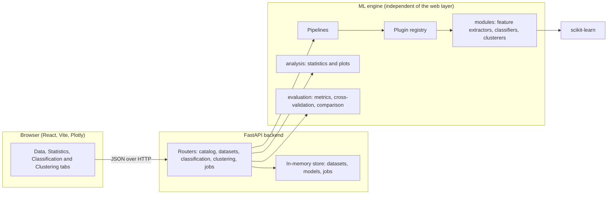

# End to End Pattern Recognition Workbench

A modular workbench that runs the whole pattern recognition pipeline in one place: **feature extraction, statistical analysis, classification, clustering and performance evaluation**. Load a dataset, explore it, build and compare pipelines from interchangeable parts, and inspect the results, all from a web interface backed by a REST API.


<!--
SCREENSHOTS: add your own images to a docs/screenshots folder, then uncomment and adjust these lines.


-->

## Why this project

Most tutorials treat feature extraction, modelling and evaluation as separate scripts. This project packages them as **independent, swappable components** behind one interface. Changing PCA to LDA, or an SVM to a random forest, is a change of configuration rather than a rewrite. A user can build several pipelines, run them side by side, and compare them with the same metrics.

## Features

**Data**
- Four built-in datasets: iris, wine, breast cancer and digits.
- CSV upload with an optional target column, columns to drop, a missing-value strategy (median, mean, zero or drop rows) and one-hot encoding of text columns.
- Targets that look like continuous numbers (many distinct values) are rejected with a clear message instead of silently becoming thousands of classes.

**Statistical analysis**
- Summary statistics with skewness, kurtosis and missing counts.
- Correlation matrix and a list of highly correlated feature pairs at a chosen threshold.
- Class balance and imbalance ratio.
- Outlier detection (IQR method in the interface; a z-score method is also available in the statistics module).
- Normality tests (Shapiro-Wilk, or D'Agostino-Pearson for large samples).
- Feature ranking that combines ANOVA F-score, mutual information and random forest importance into a mean rank.
- Plots: distributions, correlation heatmap, boxplots, class balance and a 2D PCA projection.

**Feature extraction (preprocessing)**
- Standard scaler, min-max scaler, PCA, LDA and univariate feature selection (SelectKBest).
- Steps can be chained and reordered.

**Classification**
- k-NN, Gaussian Naive Bayes, SVM, decision tree, random forest and logistic regression.
- Pipelines of any preprocessing steps plus one classifier, with parameters editable in the UI.
- Stratified k-fold cross-validation **with the whole pipeline refit inside every fold**, so scaling, PCA or feature selection never see the validation data.
- A separate held-out test set that is scored once.
- Metrics: accuracy, balanced accuracy, precision, recall and F1 (macro and weighted), Matthews correlation coefficient, ROC AUC, confusion matrix and per-class results.
- Train a pipeline as a reusable model, view its ROC curve and predict new samples.

**Clustering**
- k-means, DBSCAN, hierarchical (agglomerative) and Gaussian mixture models.
- Clustering never sees the labels. When the dataset has real classes, they are used only afterwards, to score the result and to draw a second scatter plot beside the clusters.
- Internal metrics: silhouette, Davies-Bouldin, Calinski-Harabasz. External metrics: adjusted Rand index, NMI, homogeneity, completeness and V-measure.
- A k-sweep (inertia, silhouette, Davies-Bouldin over a range of cluster counts) to help choose the number of clusters.

## Architecture



The key design idea is that the ML engine knows nothing about the web. It can be used from a notebook, a script or the API in the same way.

- **Interfaces** (`core/base.py`): every module implements `FeatureExtractor`, `Classifier` or `Clusterer`.
- **Registry** (`core/registry.py`): modules register themselves by name with a decorator. The API exposes the registry at `GET /modules`, and the frontend builds its pipeline and parameter forms from that list. A new algorithm appears in the UI without any frontend change.
- **Pipelines are plain JSON**, which is exactly what the frontend sends:
  ```json
  {
    "steps": [{"name": "standard_scaler"}, {"name": "pca", "params": {"n_components": 2}}],
    "classifier": {"name": "svm", "params": {"C": 1.0}}
  }
  ```
- **Slow work runs as background jobs**: a classification comparison is submitted, returns a job id, and the frontend polls it.

## Project structure

```
pattern-recognition-workbench/
├── backend/
│   ├── app/
│   │   ├── core/          base interfaces, registry, sklearn adapters, pipelines, dataset loading
│   │   ├── modules/       built-in plug-ins: features.py, classifiers.py, clusterers.py
│   │   ├── analysis/      stats.py, plots.py, report.py
│   │   ├── evaluation/    metrics.py, cross_val.py, compare.py, plots.py
│   │   └── api/           main.py, schemas.py, store.py, utils.py, routers/
│   ├── tests/             pytest suite (27 tests)
│   ├── pytest.ini
│   └── requirements.txt
└── frontend/
    ├── src/
    │   ├── App.jsx, api.js, params.js
    │   ├── pages/         DataPage, StatsPage, ClassificationPage, ClusteringPage
    │   └── components/    Chart, DataTable, PipelineCard, ParamEditor, ResultsPanel,
    │                      ModelPanel, ClusterView, ErrorBox
    └── package.json
```

## Getting started

### Requirements

- Python 3.10 or newer
- Node.js 20.19 or newer (or 22.12 or newer)
- Git

### 1. Clone the repository

```bash
git clone https://github.com/dhruvsaini13/pattern-recognition-workbench.git
cd pattern-recognition-workbench
```

### 2. Start the backend

```bash
cd backend
python -m venv .venv

# Windows (PowerShell)
.venv\Scripts\activate
# macOS / Linux
source .venv/bin/activate

pip install -r requirements.txt
python -m pytest -q            # optional: run the test suite
uvicorn app.api.main:app --reload
```

The API now runs at http://127.0.0.1:8000, and interactive API documentation is at http://127.0.0.1:8000/docs.

### 3. Start the frontend

Open a **second terminal**:

```bash
cd frontend
npm install
npm run dev
```

Open http://localhost:5173. The badge at the top right turns green when the frontend can reach the backend.

**Windows tip:** if PowerShell refuses to run `npm` ("running scripts is disabled"), run this once and retry:
```powershell
Set-ExecutionPolicy -Scope CurrentUser -ExecutionPolicy RemoteSigned
```

### Configuration

| Setting | Where | Default |
|---|---|---|
| Backend address used by the frontend | `VITE_API_URL` (for example in `frontend/.env.local`) | `http://localhost:8000` |
| Frontend origins allowed by the backend (CORS) | `allow_origins` in `backend/app/api/main.py` | `http://localhost:3000`, `http://localhost:5173` |
| Upload size limit | `MAX_UPLOAD_BYTES` in `backend/app/api/routers/datasets.py` | 10 MB |
| In-memory capacity | `backend/app/api/store.py` | 50 datasets, 100 models, 200 jobs |

## Using the workbench

1. **Data**: pick a built-in dataset, or upload a CSV (header row, numeric features, optional target column).
2. **Statistics**: read the overview, feature ranking, outliers, normality tests and correlations. Use the **Show** buttons for the plots.
3. **Classification**: use **Quick start** to compare every classifier, or build your own pipelines. Run the comparison, pick a pipeline to inspect its confusion matrix, then train it and predict a sample.
4. **Clustering**: run one or several algorithms, compare the scatter plot of the clusters with the real classes, and use the k-sweep to choose a cluster count.

## Example results (wine dataset)

Settings: 75/25 stratified split, 5-fold cross-validation on the training part, `random_state=42`, standard scaling, scikit-learn 1.8. You can reproduce this with **Quick start** on the Classification and Clustering tabs. Small differences between library versions are normal.

**Classification**

| Classifier | CV macro F1 (mean ± std) | Test accuracy | Test macro F1 |
|---|---|---|---|
| SVM | 0.992 ± 0.015 | 0.978 | 0.976 |
| Random forest | 0.985 ± 0.029 | 1.000 | 1.000 |
| Logistic regression | 0.978 ± 0.018 | 1.000 | 1.000 |
| Naive Bayes | 0.971 ± 0.035 | 0.978 | 0.980 |
| k-NN | 0.956 ± 0.042 | 0.933 | 0.931 |
| Decision tree | 0.933 ± 0.033 | 0.978 | 0.979 |

The test set has only 45 samples, so a single misclassified sample moves accuracy by about 2 points. That is why models are ranked by cross-validated F1, and why the test numbers should be read as a final check rather than as a ranking.

**Clustering**

| Algorithm | Clusters | Noise | Silhouette | Davies-Bouldin | Adjusted Rand |
|---|---|---|---|---|---|
| k-means (k=3) | 3 | 0 | 0.285 | 1.389 | 0.897 |
| GMM (3 components) | 3 | 0 | 0.285 | 1.389 | 0.897 |
| Hierarchical (Ward, k=3) | 3 | 0 | 0.277 | 1.419 | 0.790 |
| DBSCAN (default `eps=0.5`) | 0 | 178 | n/a | n/a | 0.000 |
| PCA(2) + DBSCAN (`eps=0.5`) | 5 | 31 | 0.523 | 0.579 | 0.379 |
| PCA(2) + DBSCAN (`eps=0.7`) | 2 | 6 | 0.480 | 0.711 | 0.437 |

- The k-sweep supports k = 3: silhouette peaks at 0.285 and Davies-Bouldin is lowest at 1.389, which matches the three real wine classes.
- DBSCAN on the 13 scaled features labels every point as noise. Density-based clustering struggles in higher dimensions, and the result changes a lot once the data is projected to two dimensions first. The workbench shows a notice when this happens instead of reporting meaningless scores.

## API overview

The full, interactive reference is at `/docs` when the backend is running.

| Area | Endpoints |
|---|---|
| Catalog | `GET /health`, `GET /modules` |
| Datasets | `GET /datasets/builtin`, `POST /datasets/builtin/{name}`, `POST /datasets/upload`, `GET /datasets`, `GET /datasets/{id}`, `GET /datasets/{id}/preview`, `DELETE /datasets/{id}` |
| Analysis | `GET /datasets/{id}/analysis`, `GET /datasets/{id}/plots/{kind}` (histograms, correlation, boxplots, class_balance, pca) |
| Classification | `POST /classification/compare`, `POST /classification/train`, `GET /models/{id}`, `POST /models/{id}/predict`, `GET /models/{id}/plots/{kind}` (confusion_matrix, confusion_matrix_normalized, roc) |
| Clustering | `POST /clustering/run`, `POST /clustering/compare`, `POST /clustering/sweep` |
| Jobs | `POST /jobs/classification/compare` (returns a job id), `GET /jobs/{id}` |

Invalid input (an unknown module, an impossible parameter such as too many LDA components, a wrong number of features for a prediction) returns HTTP 422 with a readable message, which the frontend shows directly.

## Extending the workbench

Adding an algorithm takes a few lines. For example, a gradient boosting classifier, in `backend/app/modules/classifiers.py`:

```python
from sklearn.ensemble import GradientBoostingClassifier

from ..core.adapters import SklearnClassifier
from ..core.registry import CLASSIFIERS


@CLASSIFIERS.register("gradient_boosting")
class GradientBoosting(SklearnClassifier):
    estimator_cls = GradientBoostingClassifier
    default_params = {"n_estimators": 100, "random_state": 42}
```

Restart the backend and it appears in `GET /modules`, in the classifier dropdown and in **Quick start**, with its parameters as editable fields, without touching the frontend.

- Feature extractors and clusterers work the same way, using `FEATURE_EXTRACTORS` or `CLUSTERERS` and the matching adapter in `core/adapters.py`.
- For an algorithm that is not from scikit-learn, implement the interface in `core/base.py` directly (`fit` and `predict`, plus `predict_proba` if available).
- Keep `default_params` to JSON-friendly values (numbers, strings, booleans, `None`), because the interface builds its forms from them.

Natural next modules are domain-specific feature extractors such as HOG for images, MFCC for audio or TF-IDF for text.

## Testing

```bash
cd backend
python -m pytest -q
```

The suite covers the registry and pipelines, data loading, the statistics, the metrics and cross-validation, every API endpoint, the error responses and the background job flow.

## Design decisions and limitations

- **No data leakage.** Cross-validation rebuilds and refits the entire pipeline in each fold, and the test split is touched only once.
- **Labels stay out of clustering.** They are used only for evaluation and for the comparison plot.
- **State is in memory.** Datasets, models and jobs live in the server process and are lost on restart; the oldest items are evicted when a capacity limit is reached. The server is meant to run as a single process. Replacing `store.py` with a database or cache would remove this limit without changing the routers.
- **Numeric parameters are capped** (absolute value of at most 1,000,000) so that one request cannot ask for an absurd amount of work.
- **No authentication or rate limiting.** The app is intended for local use and demos.
- **Scope.** Tabular numeric data, and classification only (no regression). The frontend has no automated tests yet.

## Tech stack

| Layer | Technology |
|---|---|
| ML and data | scikit-learn, NumPy, pandas, SciPy |
| Plots (server side) | Matplotlib |
| API | FastAPI, Pydantic, Uvicorn |
| Tests | pytest, httpx |
| Frontend | React 19, Vite 8, Plotly (`react-plotly.js`) |

## Author

Built by Dhruv Saini ([@dhruvsaini13](https://github.com/dhruvsaini13)).

<!-- LICENSE: add a LICENSE file (for example MIT) to the repository and mention it here. -->
